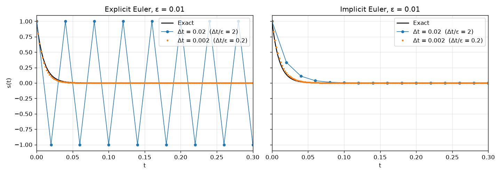
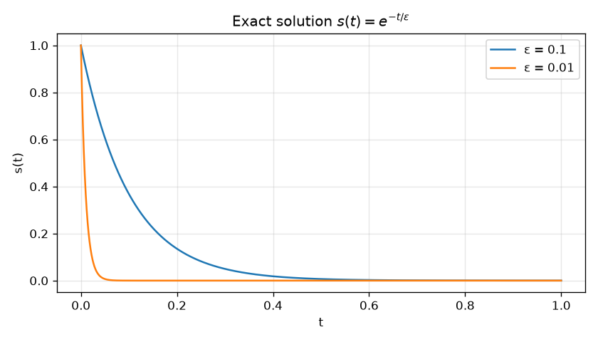
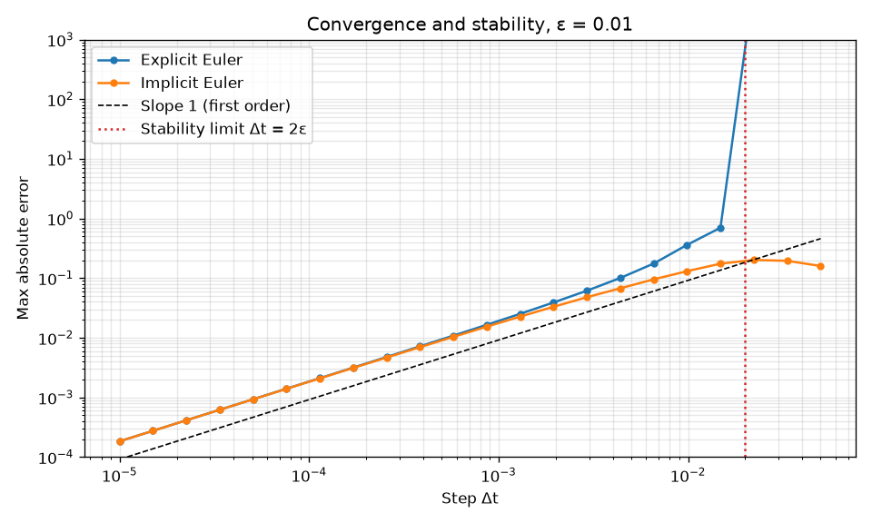
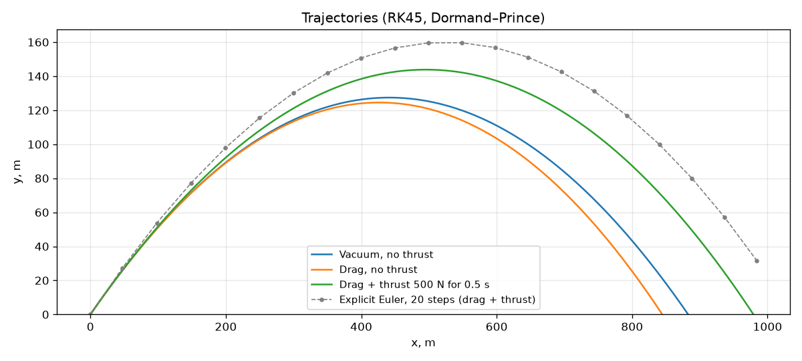
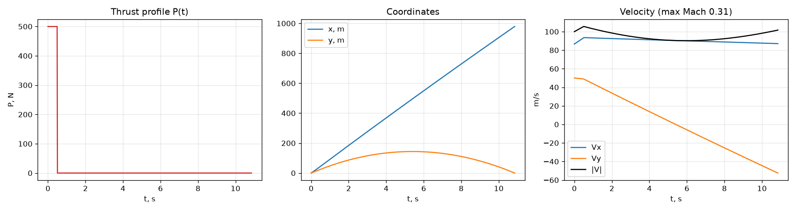
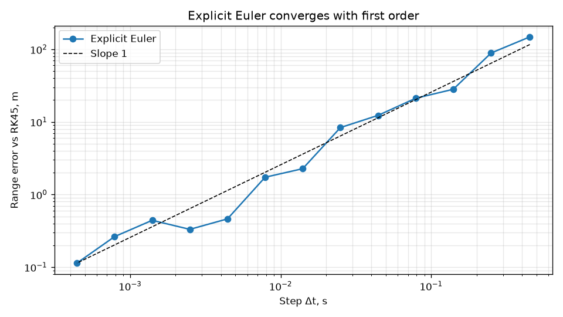

# Numerical Solution of ODEs: Stiffness and Ballistics

[](https://github.com/yndarra/differential-equations/actions/workflows/tests.yml)


**English** | [Русский](README.ru.md)

Explicit and implicit Euler methods implemented from scratch and compared with
SciPy's adaptive Dormand–Prince integrator on two problems:

1. a **stiff** linear equation, where the explicit method breaks down;
2. the **flight of a projectile** with Mach-dependent air drag and a short
   burst of rocket thrust.



> Lab work for the *Computer Modelling* university course.

## Problem 1. A stiff equation

```
ε·s' + s = 0,   s(0) = 1,   t ∈ [0, 1],   ε ≪ 1
```

The exact solution is `s(t) = exp(−t/ε)`. It decays to almost zero over a time
of order `ε`, and after that nothing interesting happens.



On this equation each explicit Euler step multiplies the solution by
`1 − Δt/ε`, so the method is stable only while `Δt ≤ 2ε`. At `ε = 0.01` the step
`Δt = 0.02` lies exactly on the stability limit, with a multiplier of −1. The
numerical solution never decays and keeps jumping between +1 and −1 (left plot
above). The implicit method multiplies by `1/(1 + Δt/ε)`, which is below 1 for
every step, so it stays stable no matter how large the step is.



* For `Δt ≪ ε` both methods converge with **first order**. The measured slopes
  are **1.01** for explicit and **0.99** for implicit Euler.
* Past `Δt = 2ε` the explicit error explodes, while the implicit error stays
  bounded.

## Problem 2. Projectile with drag and thrust

The state vector is `Y = (x, y, Vx, Vy)`, and the forces acting on the
projectile are:

* gravity `mg`;
* air drag `½·ρ·V²·S·Cx(M)` against the velocity. `Cx` depends on the Mach
  number: 0.45 at subsonic speeds, a transonic peak of 0.95, then 0.25 at high
  supersonic speeds;
* thrust `P(t)` along the velocity: 500 N during the first 0.5 s.

The projectile has mass 30 kg and caliber 0.1 m, and is launched at 100 m/s and
30°. The reference solution uses `scipy.integrate.solve_ivp` with RK45
(Dormand–Prince 5(4), the same method as `dopri5`). Integration stops at the
exact moment of impact, which is found with an event function instead of the
first point where the height goes below zero.



| Case | Range | Flight time | Apex |
|---|---|---|---|
| Vacuum, no thrust | 882.8 m | 10.19 s | 127.4 m |
| Drag, no thrust | 844.6 m | 10.08 s | 124.5 m |
| Drag + thrust | **979.2 m** | 10.85 s | 143.8 m |

The vacuum case matches the analytical range `V₀²·sin 2θ / g = 882.8 m`. The
gray dashed line is explicit Euler with only 20 steps. Its first step is longer
than the whole engine burn, so it applies the thrust for too long and overshoots
the true trajectory.



The projectile stays subsonic (maximum Mach number 0.31), so `Cx` stays constant
along the whole flight.



The range error of explicit Euler, measured against RK45, also falls with first
order. The measured slope is **1.04**.

## Getting started

```bash
git clone https://github.com/yndarra/differential-equations.git
cd differential-equations
python -m venv .venv
.venv/Scripts/activate        # Windows; on Linux/macOS: source .venv/bin/activate
pip install -r requirements.txt

python main.py                # both problems (about 10 s), images go to images/
python main.py stiff          # one problem: stiff | ballistic
```

To run the tests:

```bash
pip install -r requirements-dev.txt
pytest
```

## Project structure

```
ode_methods/
├── solvers.py    # explicit Euler, implicit Euler (Newton), convergence order
└── problems.py   # stiff equation, Cx(M), Projectile model, impact event
tests/            # convergence, stability and analytical checks
main.py           # runs both problems and draws the figures
```

## License

[MIT](LICENSE)
